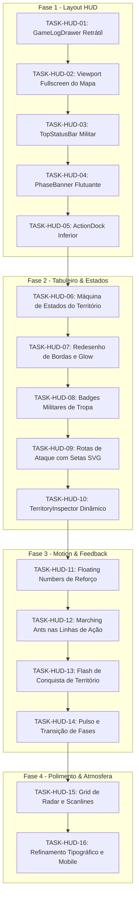

# 🗺️ ROADMAP — ATLAS WAR: TRANSIÇÃO DASHBOARD ➔ HUD DE JOGO TÁTICO

> **Status:** Aprovado para Execução  
> **Versão do Documento:** 1.0.0  
> **Escopo:** Interface de Partida (`apps/web/src/pages/MatchBoard.tsx` e componentes satélites)  
> **Direção de Arte:** *Strategic Command / Neo-Military Tactical HUD*

---

## 1. Visão Geral & Diagnóstico

### O Problema Atual
O protótipo do Atlas War foi construído com a ergonomia de um **dashboard SaaS corporativo**:
- O mapa de batalha está confinado a um card retangular interno com padding excessivo.
- O log de ações consome permanentemente ~25% da tela útil em uma sidebar lateral rígida.
- Os controles de fase e ação são botões genéricos de formulário (`ADVANCE PHASE`, `END TURN`).
- O jogador precisa "ler" textos e logs para decodificar o estado tático, em vez de visualizá-lo diretamente no mapa.

### O Objetivo Estratégico
Transformar a tela de partida em um **HUD de Videogame de Estratégia**:
1. **O mapa é o mundo do jogo:** Ocupa de 85% a 100% da área útil do viewport.
2. **Interface Flutuante (Diegética/HUD):** Todos os controles, contadores e inspeções flutuam sobre o mapa com efeito glassmorphism fosco e bordas táticas.
3. **HUD Contextual por Fase:** A interface se reconfigura dinamicamente de acordo com a fase ativa (`REINFORCEMENT`, `ATTACK`, `MOVEMENT`).
4. **Log Secundário/Retrátil:** O Game Log passa a ser um drawer deslizante sob demanda, libertando o espaço para o tabuleiro.
5. **Tabuleiro Vivo:** Países com feedback visual avançado de estado, badges militares estilizados e linhas vetoriais animadas de ataque.

---

## 2. Comparativo Estrutural: Arquitetura da Tela

### Antes: Dashboard com Sidebar Rígida
```text
┌────────────────────────────────────────────────────────┬──────────────────────┐
│ [SHIELD] ATLAS WAR   MAPA MUNDIAL · SALA 7G6RT7        │  [?] AJUDA   [X]     │
├────────────────────────────────────────────────────────┴──────────────────────┤
│ RODADA 1 · SEU TURNO                                                          │
│ [ FASE 01: Fortifique seus territórios ]      [ 1: Reforço - 2 - 3 ]          │
├────────────────────────────────────────────────────────┬──────────────────────┤
│ ┌─ MAP PANEL CARD ───────────────────────────────────┐ │ ┌─ GUIA RÁPIDO ────┐ │
│ │ ATLAS VIVO · COMANDO GLOBAL                        │ │ │ Passo 1/3        │ │
│ │ ┌────────────────────────────────────────────────┐ │ │ └──────────────────┘ │
│ │ │                                                │ │ │ ┌─ GAME LOG ──────┐ │
│ │ │                MAPA SVG (Limitado)             │ │ │ │ Turno 1 iniciado │ │
│ │ │                                                │ │ │ │ Jogador Amarelo  │ │
│ │ └────────────────────────────────────────────────┘ │ │ │ atacou Brasil... │ │
│ │ [Brasil: 2 tropas]         Amarelo / Ciano / Neutro│ │ └──────────────────┘ │
│ └────────────────────────────────────────────────────┘ │ ┌─ OBJETIVO ──────┐ │
│ ┌─ COMMAND BAR ──────────────────────────────────────┐ │ │ Conquiste o mundo│ │
│ │ [Reforços: 3]  [Info da Fase]   [Avançar] [Passar] │ │ └──────────────────┘ │
│ └────────────────────────────────────────────────────┘ └──────────────────────┘
└───────────────────────────────────────────────────────────────────────────────┘
```

### Depois: Full-Viewport Tactical Game HUD
```text
┌───────────────────────────────────────────────────────────────────────────────┐
│ [◈] SECTOR: 7G6RT7        ROUND 01        RESERVES: 03        ● YOUR TURN [?] │
│ ───────────────────────────────────────────────────────────────────────────── │
│                                                                               │
│               ┌─────────────────────────────────────────────┐                 │
│               │           REINFORCEMENT PROTOCOL            │                 │
│               │  Deploy 3 reserves to controlled territories│                 │
│               └─────────────────────────────────────────────┘                 │
│                                                                               │
│                                                                               │
│                              T A C T I C A L                                  │
│                                W O R L D                                      │
│                                                                               │
│                   ╭──────╮                      ╭──────╮                      │
│                   │ ◈ 04 │ ─ ─ ─ ─ ─ ─ ─ ─ ─ ─▶│ ◈ 01 │                      │
│                   ╰──────╯                      ╰──────╯                      │
│                   [BRAZIL]                     [ARGENTINA]                    │
│                                                                               │
│                                                                               │
│ ┌────────────────────────┐                                 ┌────────────────┐ │
│ │ ◉ OBJECTIVE            │                                 │ ☰ GAME LOG [3] │ │
│ │ Conquiste 24 territórios│                                 │   (Clique p/   │ │
│ └────────────────────────┘                                 │    abrir)   ▲  │ │
│                     ╭─────────────────────────╮            └────────────────┘ │
│                     │  🛡       ⚔       ⇄     │    ┌───────────────┐          │
│                     │ REINFORCE ATTACK  MOVE  │    │  END TURN →   │          │
│                     │ ═════════               │    └───────────────┘          │
│                     ╰─────────────────────────╯                               │
└───────────────────────────────────────────────────────────────────────────────┘
```

---

## 3. Arquitetura de Componentes React

```text
apps/web/src/
├── pages/
│   ├── MatchBoard.tsx                 # Orquestrador de estado e layout HUD
│   └── MatchBoard.css                 # CSS do layout fullscreen e viewports
├── components/
│   ├── hud/
│   │   ├── TopStatusBar.tsx           # Setor, rodada, timer, status de turno e pool
│   │   ├── PhaseBanner.tsx            # Banner contextual flutuante superior
│   │   ├── ActionDock.tsx             # Dock inferior tático de fases e passagem de turno
│   │   ├── TerritoryInspector.tsx     # Card flutuante dinâmico do território ativo/alvo
│   │   ├── GameLogDrawer.tsx          # Drawer retrátil do feed de eventos (380px)
│   │   └── ObjectiveBadge.tsx         # Widget flutuante de objetivo militar
│   └── map/
│       ├── AtlasMap.tsx               # Container SVG principal com viewBox responsivo
│       ├── AtlasMap.css               # Estilos dos países, bordas, markers e animações
│       ├── TerritoryPath.tsx          # Renderizador do path com estados táticos
│       ├── TroopBadge.tsx             # Badge militar com glyph de infantaria e contador
│       ├── AttackRoute.tsx            # Linhas SVG tracejadas animadas (marching ants)
│       └── TacticalOverlay.tsx        # Grid militar, coordenadas e radar sutil
```

---

## 4. Sistema de Design: "Strategic Command / Neo-Military"

### Paleta Cromática Tática
| Token | Cor Hex | Uso |
| :--- | :--- | :--- |
| `--hud-bg` | `#040810` | Fundo abissal do oceano e tela base |
| `--hud-surface-1` | `#07101D` | Painéis e drawers flutuantes (85% opacidade + blur) |
| `--hud-surface-2` | `#0B1627` | Elementos de controle e badges internos |
| `--hud-border` | `#1A2F4C` | Bordas e grades táticas secundárias |
| `--color-player` | `#00D9F5` / `#16D6ED` | Jogador ativo (Ciano de comando) |
| `--color-enemy` | `#FFD600` / `#FFD400` | Inimigo principal (Amarelo tático) |
| `--color-player-3` | `#8B4CC4` | Terceiro jogador (Púrpura imperial) |
| `--color-danger` | `#FF475D` | Indicador de ataque / perigo iminente |
| `--color-neutral` | `#1B2A40` | Território neutro / mar não disputado |
| `--text-primary` | `#EDF8FF` | Tipografia de alta ênfase |
| `--text-secondary`| `#7892A8` | Subtítulos, rótulos e coordenadas |

### Tipografia & Hierarquia
- **Display / HUD Counters:** `Rajdhani`, `Chakra Petch` ou `Oxanium` (Sans-serif militar condensada com números monospaçados).
- **Interface / Labels:** `Inter`, `system-ui` para máxima legibilidade de regras e logs.

---

## 5. Detalhamento das Fases & Tarefas de Implementação



---

### ETAPA 1 — Layout & Arquitetura de Tela (HUD Fullscreen)
*Objetivo:* Eliminar o visual de painel administrativo, colocar o mapa no centro de 100% da viewport e criar os componentes flutuantes de comando.

#### 📌 TASK-HUD-01: Desacoplamento da Sidebar e Implementação do `GameLogDrawer`
- **Contexto:** Atualmente `GameFeed` ocupa 25% da tela permanentemente em `.match-sidebar`.
- **Implementação:**
  - Criar o componente `GameLogDrawer.tsx` com estado aberto/fechado (`isDrawerOpen`).
  - Posicionar botão gatilho flutuante no canto inferior direito: `☰ GAME LOG [QTD_NOVOS] ↑`.
  - Drawer deslizante pela lateral direita (380px de largura, overlay blur escuro, cabeçalho tático e lista de eventos com ícones temáticos).
  - Fechamento por backdrop click, tecla `Esc` ou botão fechar `[×]`.
- **Arquivos:**
  - `apps/web/src/components/hud/GameLogDrawer.tsx` (novo)
  - `apps/web/src/components/hud/GameLogDrawer.css` (novo)
  - `apps/web/src/pages/MatchBoard.tsx` (integração)
- **Critérios de Aceite:**
  - [ ] A tela de jogo não possui sidebar permanente ocupando espaço horizontal.
  - [ ] O botão do log indica visualmente quando novos eventos acontecem no turno.
  - [ ] Ao clicar, o drawer desliza suavemente sobre o mapa sem quebrar o layout.

#### 📌 TASK-HUD-02: Expansão do `WorldMap` para Fullscreen Viewport
- **Contexto:** O mapa hoje reside dentro de um container com altura máxima restrita (`min(58vw, 595px)`).
- **Implementação:**
  - Modificar `.match-screen` e `.map-wrap` para preencher 100vw e 100vh (descontando apenas a barra superior de 50px).
  - O mapa SVG passa a atuar como canvas de fundo interativo (`preserveAspectRatio="xMidYMid meet"`).
  - Garantir suporte a pan/zoom ou centralização matemática do mapa em resoluções widescreen e ultrawide.
- **Arquivos:**
  - `apps/web/src/pages/MatchBoard.css`
  - `apps/web/src/components/AtlasMap.css`
- **Critérios de Aceite:**
  - [ ] O mapa ocupa pelo menos 90% da altura visível da tela.
  - [ ] Não há barras de rolagem desnecessárias na página principal durante a partida.

#### 📌 TASK-HUD-03: Implementação da `TopStatusBar` Militar
- **Contexto:** O cabeçalho atual usa estilo web padrão com breadcrumbs e botões genéricos.
- **Implementação:**
  - Criar `TopStatusBar.tsx` contendo:
    - Esquerda: Identificador do Setor (`SECTOR: 7G6RT7`), Rodada (`ROUND 01`).
    - Centro: Indicador tático de turno (`SEU TURNO` destacado em ciano pulsante vs `AGUARDANDO OPONENTE` em cinza).
    - Direita: Contador militar de reforços disponíveis (`RESERVES: XX`), status de conexão WebSocket e botão discreto de menu/ajuda.
  - Fundo translúcido tático com borda inferior fina (`#1A2F4C`).
- **Arquivos:**
  - `apps/web/src/components/hud/TopStatusBar.tsx` (novo)
  - `apps/web/src/components/hud/TopStatusBar.css` (novo)
- **Critérios de Aceite:**
  - [ ] Informações de rodada, turno e reforços visíveis em um relance sem rolagem.
  - [ ] O status do turno do jogador possui ênfase visual imediata (luz verde/ciano).

#### 📌 TASK-HUD-04: Criação do `PhaseBanner` Flutuante Contextual
- **Contexto:** A barra horizontal de fases atual é fixa e ocupa espaço vertical valioso.
- **Implementação:**
  - Criar um HUD flutuante no topo do mapa, abaixo da status bar:
    - **Reforço:** `REINFORCEMENT PROTOCOL` + `Distribua suas tropas nos territórios sob seu controle.`
    - **Ataque:** `ATTACK PROTOCOL` + `Selecione um território de origem e mire uma fronteira inimiga.`
    - **Manobra:** `TACTICAL REDEPLOYMENT` + `Mova tropas entre territórios aliados conectados.`
  - Ações contextuais rápidas acopladas ao banner quando há território selecionado.
- **Arquivos:**
  - `apps/web/src/components/hud/PhaseBanner.tsx` (novo)
  - `apps/web/src/components/hud/PhaseBanner.css` (novo)
- **Critérios de Aceite:**
  - [ ] O banner flutua sobre o oceano do mapa sem bloquear nós estratégicos.
  - [ ] A mensagem muda instantaneamente ao avançar de fase no motor de jogo.

#### 📌 TASK-HUD-05: Construção do `ActionDock` Inferior com `END TURN` Destacado
- **Contexto:** A barra de comandos atual é uma barra cinza genérica com botões administrativos.
- **Implementação:**
  - Criar doca tática centralizada na parte inferior da tela (`ActionDock.tsx`):
    - 4 abas/ícones de ação tática:
      - `🛡 REINFORCE` (ativo na fase 1)
      - `⚔ ATTACK` (ativo na fase 2)
      - `⇄ MOVE` (ativo na fase 3)
      - `◈ INTEL` (acesso rápido a objetivos e cartas)
    - Indicador de iluminação neon na fase atual.
    - Botão isolado à direita: `END TURN →` com confirmação visual para evitar toques acidentais.
- **Arquivos:**
  - `apps/web/src/components/hud/ActionDock.tsx` (novo)
  - `apps/web/src/components/hud/ActionDock.css` (novo)
- **Critérios de Aceite:**
  - [ ] O dock transmite sensação de painel de controle tático militar.
  - [ ] Transição visual clara e iluminada entre as fases.
  - [ ] O botão `END TURN` possui identidade visual destacada e proteção contra duplo clique.

---

### ETAPA 2 — Tabuleiro Tático & Máquina de Estados (Board)
*Objetivo:* Transformar a malha geográfica em um tabuleiro de guerra vivo com diferenciação rica de estados, badges táticos e trajetórias de combate.

#### 📌 TASK-HUD-06: Máquina de Estados dos Territórios no SVG
- **Contexto:** Atualmente os territórios têm apenas estilos simplórios de preenchimento.
- **Implementação:**
  - Formalizar os estados de cada território através de classes e atributos SVG:
    ```typescript
    type TerritoryVisualState =
      | 'default'
      | 'hover'
      | 'selectable'
      | 'selected'
      | 'attackable'
      | 'under-attack'
      | 'captured'
      | 'disabled';
    ```
  - Preenchimento do território com a cor do jogador dono (`fill: var(--owner-color)` com opacidade calibrada em 35% a 55%).
  - Territórios neutros/inativos em azul-marinho tático (`#111C35`).
- **Arquivos:**
  - `apps/web/src/components/AtlasMap.tsx`
  - `apps/web/src/components/AtlasMap.css`
- **Critérios de Aceite:**
  - [ ] Territórios elegíveis para a ação atual (ex.: aliados com >1 tropa no ataque) recebem realce `selectable`.
  - [ ] Territórios inimigos adjacentes ao nó selecionado recebem pulso `attackable`.

#### 📌 TASK-HUD-07: Redesenho de Bordas, Fronteiras e Filtros Glow
- **Contexto:** As linhas atuais são uniformes e dão aparência de mapa de referência escolar.
- **Implementação:**
  - Bordas externas de países: `stroke-width: 1.8px; stroke: rgba(43, 107, 170, 0.45);`.
  - Fronteiras internas entre territórios aliados: `stroke-width: 1px; stroke-dasharray: 2 2;`.
  - Território selecionado: `stroke: #65EDFF; stroke-width: 2.5px; filter: url(#tacticalGlow);`.
  - Criação de filtro SVG `<filter id="tacticalGlow">` refinado (sem saturação excessiva).
- **Arquivos:**
  - `apps/web/src/components/AtlasMap.tsx`
  - `apps/web/src/components/AtlasMap.css`
- **Critérios de Aceite:**
  - [ ] O mapa ganha contraste nítido de tabuleiro sem poluição visual.
  - [ ] O território selecionado é inequívoco em qualquer nível de zoom.

#### 📌 TASK-HUD-08: Redesenho dos `TroopBadges` Militares
- **Contexto:** Marcadores atuais são círculos simples com números (`○ 1`).
- **Implementação:**
  - Substituir círculos por **Military Troop Badges** chanfrados/arredondados:
    - Centro em preto tático profundo (`#050B14`).
    - Borda colorida de 2px correspondente ao proprietário.
    - Ícone micro de patente/infantaria (`◈`) ao lado da numeração formatada com 2 dígitos (`03`, `12`).
    - Escalas de badge por densidade de exército:
      - `1–9`: Badge compacto (28x22px)
      - `10–49`: Badge médio reforçado (34x24px)
      - `50+`: Badge elite com coroa/chevrons táticos
- **Arquivos:**
  - `apps/web/src/components/map/TroopBadge.tsx` (novo)
  - `apps/web/src/components/AtlasMap.css`
- **Critérios de Aceite:**
  - [ ] O número de tropas é legível à distância.
  - [ ] A cor do exército é reconhecida instantaneamente pelo badge.

#### 📌 TASK-HUD-09: Rotas Vetoriais de Ataque e Manobra (`AttackRoutes`)
- **Contexto:** As arestas atuais são linhas retas cinzas estáticas entre nós.
- **Implementação:**
  - Renderizar arcos estratégicos curvados ou linhas vetoriais com marcador de ponta de flecha (`marker-end="url(#arrow)"`).
  - Durante a fase de ataque com origem selecionada, desenhar linhas destacadas em vermelho/laranja apontando para os alvos válidos.
  - Durante a fase de manobra, desenhar rotas azuis/verdes para territórios aliados.
- **Arquivos:**
  - `apps/web/src/components/map/AttackRoute.tsx` (novo)
  - `apps/web/src/components/AtlasMap.tsx`
- **Critérios de Aceite:**
  - [ ] Ao clicar em um território com tropas, os vetores de ação para países vizinhos surgem imediatamente.
  - [ ] O jogador entende as opções de ataque sem precisar memorizar a lista de adjacências.

#### 📌 TASK-HUD-10: Criação do `TerritoryInspector` Contextual
- **Contexto:** O card de seleção atual é um bloco estático no canto inferior esquerdo.
- **Implementação:**
  - Criar um painel flutuante tático que surge quando um território é clicado:
    - Nome do Território (ex.: `BRAZIL - SETOR SUL`).
    - Proprietário com insígnia colorida e quantidade de divisões.
    - Se for território próprio na fase de reforço: Controles rápidos `[ - ] [ 03 ] [ + ]` e botão `[ DEPLOY ]`.
    - Se for território inimigo em ataque: Balanço de poder comparativo (Tropas Atacantes vs Tropas Defensoras) e botão `[ ENGAGE ]`.
- **Arquivos:**
  - `apps/web/src/components/hud/TerritoryInspector.tsx` (novo)
  - `apps/web/src/components/hud/TerritoryInspector.css` (novo)
- **Critérios de Aceite:**
  - [ ] O jogador pode reforçar ou disparar ataque diretamente pelo inspector sem depender de modal intrusivo.
  - [ ] Exibe os dados táticos de forma clara e limpa.

---

### ETAPA 3 — Motion, Feedback & Micro-Interações (Motion)
*Objetivo:* Dar vida ao jogo através de animações funcionais focadas em eventos sem degradar o FPS.

#### 📌 TASK-HUD-11: Animação de Reforço com Floating Numbers (`+N`)
- **Contexto:** Adicionar reforços atualmente apenas atualiza o número instantaneamente.
- **Implementação:**
  - Ao despachar reforços, renderizar um elemento flutuante `+N` na posição do badge:
    - Animação CSS subindo 25px com fade-out em 600ms.
    - Cor correspondente ao jogador (ciano/amarelo).
    - Leve efeito sonoro / vibração tática visual.
- **Arquivos:**
  - `apps/web/src/components/map/TroopBadge.tsx`
  - `apps/web/src/components/AtlasMap.css`
- **Critérios de Aceite:**
  - [ ] O feedback de alocação de tropas é visualmente gratificante e perceptível.
  - [ ] Não há vazamento de memória ou acúmulo de nós DOM após a animação.

#### 📌 TASK-HUD-12: Marching Ants nas Linhas de Ação e Ataque
- **Contexto:** As conexões de ataque são estáticas.
- **Implementação:**
  - Aplicar animação contínua de `stroke-dashoffset` nas rotas ativas:
    ```css
    @keyframes marchVector {
      from { stroke-dashoffset: 24; }
      to { stroke-dashoffset: 0; }
    }
    .atlas-attack-vector {
      stroke-dasharray: 6 6;
      animation: marchVector 0.8s linear infinite;
    }
    ```
- **Arquivos:**
  - `apps/web/src/components/AtlasMap.css`
- **Critérios de Aceite:**
  - [ ] O fluxo visual da seta direciona a atenção claramente do atacante para o defensor.

#### 📌 TASK-HUD-13: Animação de Conquista de Território
- **Contexto:** Quando um território é conquistado, a cor apenas troca abruptamente.
- **Implementação:**
  - Sequência de animação ao detectar mudança de `owner_id`:
    1. Pulso rápido da cor inimiga (100ms)
    2. Flash branco de impacto militar (150ms)
    3. Transição suave de preenchimento para a cor do conquistador com expansão do badge (350ms).
- **Arquivos:**
  - `apps/web/src/components/AtlasMap.tsx`
  - `apps/web/src/components/AtlasMap.css`
- **Critérios de Aceite:**
  - [ ] A conquista de um território gera forte sensação de recompensa e clareza de evento.

#### 📌 TASK-HUD-14: Pulso e Transições Fluidas de Fase
- **Contexto:** Mudanças de fase são secas e parecem transições de página web.
- **Implementação:**
  - Adicionar transição sutil no `PhaseBanner` (slide-down de 15px com fade-in ao alterar fase).
  - Sombras pulsantes discretas (`box-shadow` tático ciano/dourado) nos elementos interativos pertinentes à nova fase.
- **Arquivos:**
  - `apps/web/src/components/hud/PhaseBanner.css`
  - `apps/web/src/components/hud/ActionDock.css`
- **Critérios de Aceite:**
  - [ ] O jogador é alertado da mudança de fase sem travamento visual.

---

### ETAPA 4 — Identidade Neo-Military & Polimento Visual (Polish)
*Objetivo:* Unificar a direção de arte e criar uma estética de ficção científica militar contemporânea de alto padrão.

#### 📌 TASK-HUD-15: Overlay de Atmosfera Tática (Radar, Grid & Scanlines)
- **Contexto:** O fundo do mapa atualmente é um bloco liso de cor azulada.
- **Implementação:**
  - Camada de fundo de oceano com padrão sutil de grade tática (grid náutico/aéreo a 4% de opacidade).
  - Anéis concêntricos de radar girando lentamente com opacidade de 8%.
  - Linhas de latitude e longitude desenhadas com tipografia militar nos eixos (`EQ`, `30°N`, `60°S`).
  - Efeito scanline procedural ultraleve (2% opacidade) que não prejudica a nitidez dos textos.
- **Arquivos:**
  - `apps/web/src/components/map/TacticalOverlay.tsx` (novo)
  - `apps/web/src/components/AtlasMap.css`
- **Critérios de Aceite:**
  - [ ] O visual transmite sensação imediata de sala de comando de operações militares do futuro.
  - [ ] O uso de GPU/CPU permanece abaixo de 60fps constantes sem gargalos de renderização.

#### 📌 TASK-HUD-16: Hierarquia Tipográfica e Responsividade de HUD
- **Contexto:** Textos usam tamanhos semelhantes e fontes genéricas.
- **Implementação:**
  - Importação de tipografia militar consagrada (ex.: `Rajdhani` / `Chakra Petch` via Google Fonts).
  - Aplicação estrita da escala de tamanhos de HUD:
    - Display/Valores táticos: 24–32px
    - Título de Fase: 20–24px
    - Rótulos e Badges: 11–13px
    - Coordenadas e Micro-textos: 9–10px
  - Ajuste ergonômico para telas menores (smartphones/tablets): os controles se recolhem em docks compactos e o zoom foca nos territórios de ação.
- **Arquivos:**
  - `apps/web/src/index.css`
  - `apps/web/src/pages/MatchBoard.css`
- **Critérios de Aceite:**
  - [ ] Hierarquia de leitura perfeita: o olho do jogador é guiado para onde a ação acontece.
  - [ ] Interface utilizável em resoluções desde 1280x720 até 4K e dispositivos móveis.

---

## 6. Matriz de Tarefas, Prioridades & Dependências

| ID | Tarefa | Fase | Prioridade | Esforço | Status |
| :--- | :--- | :--- | :--- | :--- | :--- |
| `TASK-HUD-01` | `GameLogDrawer` Retrátil (380px) | Etapa 1 | P0 | Médio | ✅ Concluído |
| `TASK-HUD-02` | `WorldMap` Fullscreen Viewport | Etapa 1 | P0 | Médio | ✅ Concluído |
| `TASK-HUD-03` | `TopStatusBar` Militar | Etapa 1 | P1 | Baixo | ✅ Concluído |
| `TASK-HUD-04` | `PhaseBanner` Flutuante | Etapa 1 | P1 | Médio | ✅ Concluído |
| `TASK-HUD-05` | `ActionDock` Inferior + `END TURN` | Etapa 1 | P0 | Médio | ✅ Concluído |
| `TASK-HUD-06` | Máquina de Estados de Territórios | Etapa 2 | P0 | Médio | ✅ Concluído |
| `TASK-HUD-07` | Redesenho de Bordas & Glow SVG | Etapa 2 | P1 | Baixo | ✅ Concluído |
| `TASK-HUD-08` | `TroopBadges` Militares Escalonados | Etapa 2 | P1 | Médio | ✅ Concluído |
| `TASK-HUD-09` | `AttackRoutes` com Vetores SVG | Etapa 2 | P1 | Médio | ✅ Concluído |
| `TASK-HUD-10` | `TerritoryInspector` Contextual | Etapa 2 | P1 | Médio | ✅ Concluído |
| `TASK-HUD-11` | Floating Numbers de Reforço (`+N`) | Etapa 3 | P2 | Baixo | ✅ Concluído |
| `TASK-HUD-12` | Marching Ants em Vetores de Ataque| Etapa 3 | P2 | Baixo | ✅ Concluído |
| `TASK-HUD-13` | Flash de Conquista de Território | Etapa 3 | P2 | Médio | ✅ Concluído |
| `TASK-HUD-14` | Pulso e Transições Fluidas de Fase| Etapa 3 | P2 | Baixo | ✅ Concluído |
| `TASK-HUD-15` | Atmosfera Tática: Radar & Scanlines| Etapa 4 | P3 | Médio | ✅ Concluído |
| `TASK-HUD-16` | Tipografia HUD & Responsividade | Etapa 4 | P2 | Baixo | ✅ Concluído |


---

## 7. Diretrizes Técnicas e Regras Invioláveis

1. **Backend Autoritativo Intacto:** O frontend não calcula vitória de combate, nem move tropas localmente. As ações continuam despachadas via `sendAction('place_reinforcement' | 'attack' | 'move_troops' | 'advance_phase' | 'end_turn')` para `apps/api`.
2. **SVG ao invés de Canvas:** Manter a renderização dos países e arestas em SVG nativo. Isso assegura eventos nativos de clique, acessibilidade (`tabIndex`, `aria-label`), estilização via variáveis CSS e compatibilidade com vetores GeoJSON.
3. **Zero Layout Shifts:** O mapa nunca deve "pular" de tamanho quando painéis ou drawers abrirem. Elementos flutuantes utilizam `position: absolute` ou `position: fixed` com `backdrop-filter: blur(8px)`.
4. **Desempenho Visual 60 FPS:** Não aplicar filtros `feGaussianBlur` pesados em elementos que se movem a cada frame. Usar `will-change: transform` e acelerar transições via CSS hardware acceleration.
